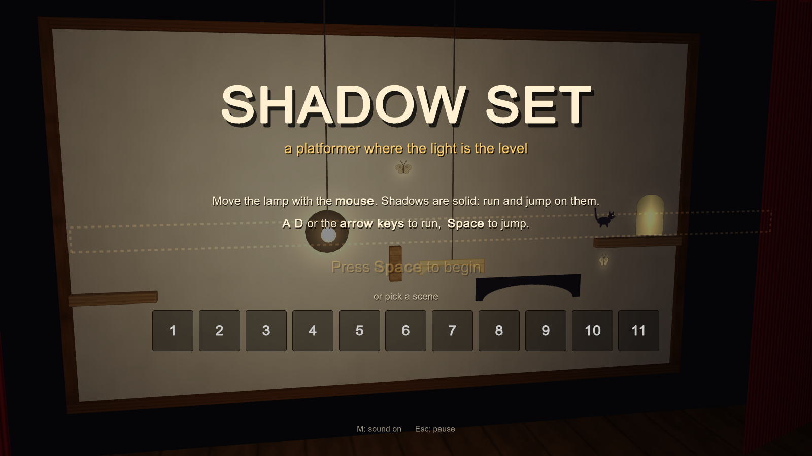
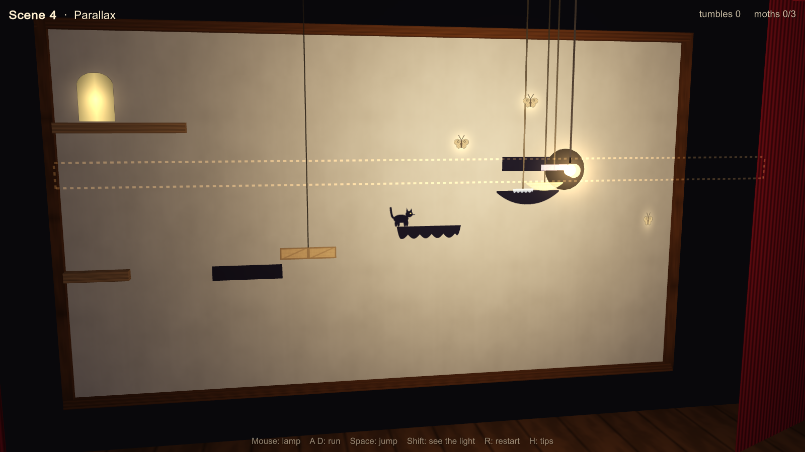
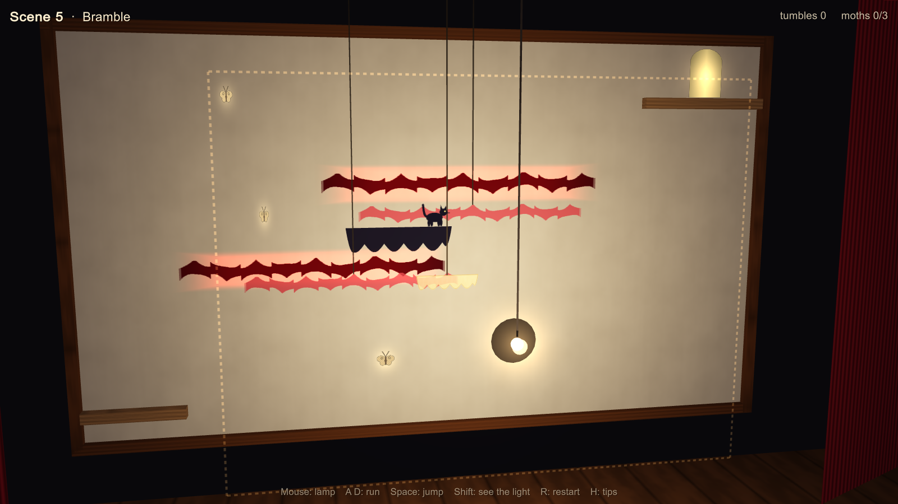
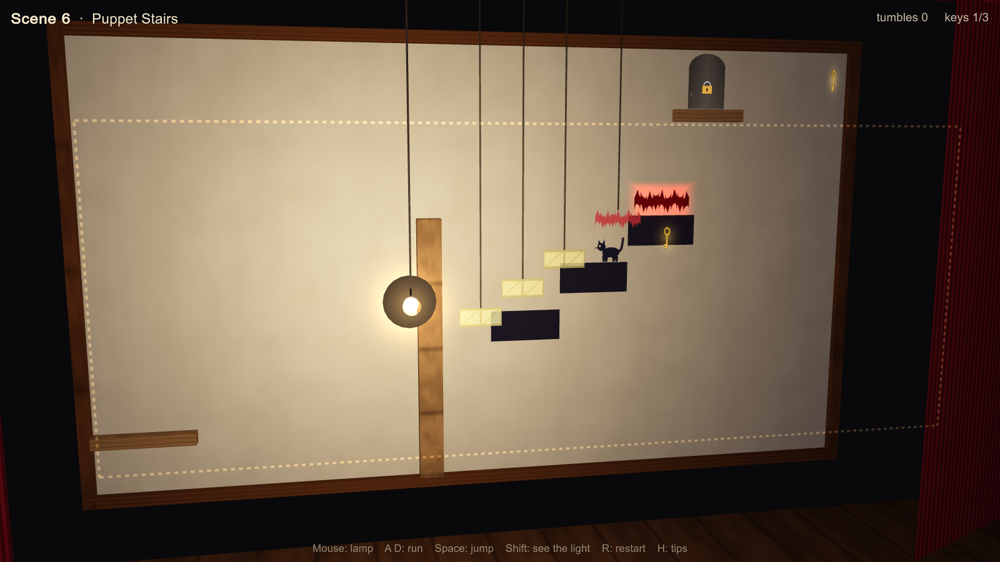
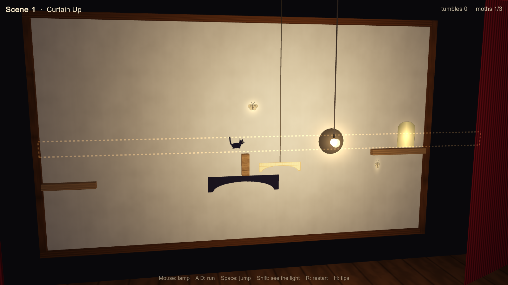
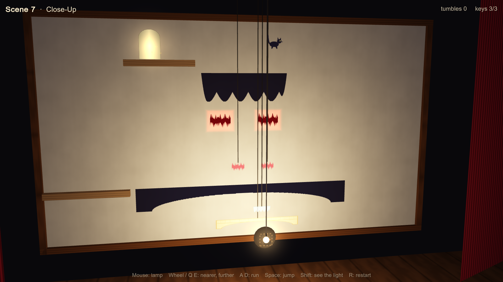
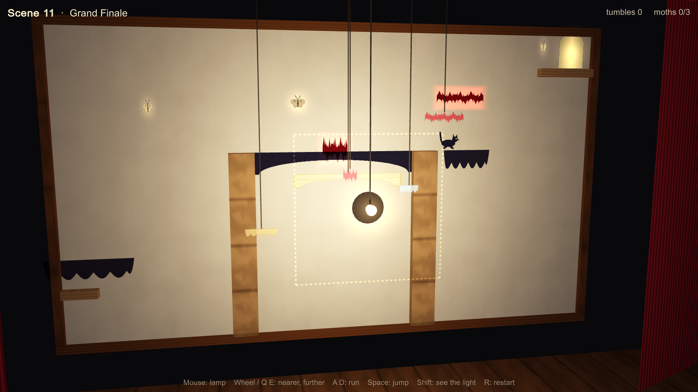

# Shadow Set

*A platformer where the light is the level.*

A little theatre: a paper wall, a lamp, and paper cut-outs hanging on rods between them.
**You move the lamp with the mouse. The cut-outs' shadows on the wall are solid**, and your hero,
a shadow cat, runs and jumps across them with the keyboard.

Every cut-out is a stage prop (a footbridge, a cloud, a rowing boat, a crate, a bramble) hanging at its own depth, and that one rule drives the whole game:

- **Near the wall**, a cut-out's shadow barely moves when the lamp moves.
- **Near the lamp**, its shadow is big and swings fast, the opposite way to the lamp.
- **Lamp closer to the wall:** every shadow swells outwards from it. **Lamp further away:** they shrink back.

So one sweep of the mouse moves every platform in the level at once, each at its own speed. You
stand on a shadow and ride it, line up shadows into a staircase, steer a lift through a maze of thorny
shadows, or zoom a scrap of card into a bridge. You do all of this while running and jumping in real time.



## Ten scenes, one idea each

| Scene | Name | What it teaches |
|---|---|---|
| 1 | Curtain Up | Shadows are solid. Stand on one and move the lamp to ride it. Two cut-outs at the same depth move as one: ride the low one out (jump the post on the way), then the high one back to the door. |
| 2 | Stage Lift | Lowering the lamp raises shadows. A cut-out nearer the lamp is a faster lift. Don't get squashed. |
| 3 | Free Hand | The lamp goes anywhere. Steer your lift round the first thorn, over the wall, then change to a slower shadow to get under the beam. |
| 4 | Parallax | Four stepping stones at four depths slide at four speeds. Line each one up with the next. |
| 5 | Bramble | A whole maze of thorns, hung near the wall so they hardly move. Steer your lift through it, right to left. |
| 6 | Puppet Stairs | One cut-out of a whole staircase, moving as one piece. Climb it, carry it over the wall, then hop down a step while it moves to slip under the thorns (or lower the whole thing). |
| 7 | Double Act | Two lamps, each throwing its own shadow into its own half of the room. Park one to step across to the other, then park it again above the thorns to step back. |
| 8 | Clockwork | Cut-outs on motors swing by themselves. Time it, or nudge the lamp to steady them. |
| 9 | Close-Up | The lamp stays put; you only bring it nearer or further. Grow a bridge, shrink it again so a cloud sinks to meet you, then ride the cloud up while walking back to its middle: it grows outwards, and there are thorns either side. |
| 10 | Grand Finale | Three rooms: zoom, move, time, steer. |

**Every scene has three keys, and the door stays padlocked until you have all of them.** They hang where getting them takes thought and timing: under a shelf you can only ride beneath, at the far end of a ride, on top of the ceiling of a lift shaft, tucked under the thorns where only the lower step fits, at the top of a swing, on top of a lift that swells as you zoom in.

| | |
|---|---|
|  |  |
|  |  |
|  |  |

## Controls

| | |
|---|---|
| Move the lamp | **Mouse** (or I J K L) |
| Lamp nearer / further (scene 9 on) | **Scroll wheel** (or Q / E) |
| Pick up the other lamp (scene 7) | **Right click** (or Tab) |
| Run | **A D** or **← →** |
| Jump (hold for higher) | **Space**, W, ↑ or Z |
| See the light: fade the cut-outs, show the rays | hold **Shift** |
| Restart / tips / pause / sound | **R** / **H** / **Esc** / **M** |
| Skip to the next scene | **N** |

## Running it

- **Windows:** `Builds/Windows/ShadowSet.exe`.
- **Any computer with a browser (Mac, Linux, Chromebook):** host the `Builds/Web` folder on any static
  host (itch.io, GitHub Pages), or run `py -m http.server` inside it and open http://localhost:8000.
- **In Unity:** open this folder with Unity 6 (6000.5.10f1). Use the *Shadow Set* menu to build.
  The scene is empty: the whole game builds itself in code when it starts.

It is made to run smoothly on modest machines:
- built-in render pipeline
- five small hand-written shaders, with no real-time shadow maps (the shadows are computed geometry)
- a few dozen draw calls
- every texture and sound generated in code, so there are no asset files to load

## How it's built

**The shadows are exact.** A flat cut-out parallel to the wall throws a shadow that is the same shape, scaled
around the lamp by `k = D / (D − d)`, where `D` is the lamp's distance from the wall and `d` is the
cut-out's. Every cut-out is made of rectangles, so every shadow is a rectangle, and the platforming is
crisp box collision. The shadows on screen are drawn from exactly the same numbers.

**Riding a shadow.** When the shadow under you moves, the game works out which point on the cut-out you're
standing over, and puts you back over that same point after the lamp moves. So you are carried along,
up, or outwards as it grows. A shadow sweeping into you pushes you, and if there's no way out you're squashed.

**The simulation is separate from Unity.** All the gameplay (`Assets/Scripts/Sim`) is plain C# with no Unity
types. It steps at a fixed 120 Hz, so it plays the same at any frame rate, and Unity only draws it and reads the
controls (`Assets/Scripts/Game`).

**Every level is tested by bots** (40 runs in all). `Tools/SimTest` compiles the simulation on its own, using the Mono that ships
with Unity, and plays:
- **a scripted solution for every scene** that collects all three keys, to prove it can be finished
- **the old route straight to the door, without the keys**, which must now be stuck at the padlock
- **cheats that must fail** (lifting straight through a thorn, jumping gaps without lining the stones up, going straight across
  the bramble, zooming without keeping to the middle, using only one lamp...), to prove each scene's idea is actually needed

It also draws levels as PNGs, including every shadow the lamp can throw, which is how the levels were designed.
The same solution scripts play the first scene behind the title screen.

```
Tools/SimTest/build.sh && mono Tools/SimTest/SimTest.exe bots
```

| Path | What's in it |
|---|---|
| `Assets/Scripts/Sim/Sim.cs` | lamps, shadows, the hero's movement, riding, squashing, thorns and keys |
| `Assets/Scripts/Sim/Levels.cs` | the ten scenes, with the shadow maths in the header |
| `Assets/Scripts/Sim/Bots/` | the scripted solutions and the cheats that must fail |
| `Assets/Scripts/Game/` | the theatre (View), the menus and controls (Game), procedural art (Art), synthesised sound (Sfx) |
| `Assets/Resources/Shaders/` | lamp lighting on everything, and multiply-blended shadows on the paper |
| `Assets/Editor/Build.cs` | project setup and Windows / WebGL builds |
| `Tools/SimTest/` | the level-design and testing tool |

## With more time

- Cut-outs that rotate (shadows that tilt into ramps), and coloured gels that make shadows of one colour solid
- A level editor in the game, drawing cut-outs straight onto the rig
- Gamepad support: one stick for the cat, the other for the lamp

## Credits

Made by Yasmin Tazi, built with AI assistance (Claude), as encouraged in the brief. Made with Unity.
